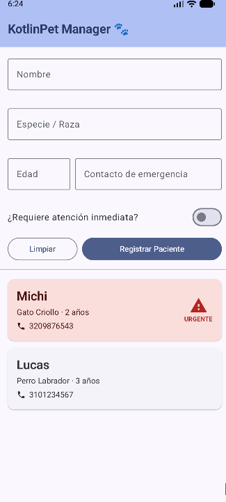

# KotlinPet Manager 

**Estudiante:** Jhon Clarence Ramírez Ortiz
**Código:** 1193332650
**Asignatura:** Desarrollo de Aplicativos Móviles (EE053)
**Proyecto 1:** App "KotlinPet Manager"

## Descripción de la aplicacion

KotlinPet Manager es una aplicación Android de una sola pantalla para una clínica veterinaria. Permite registrar pacientes con su nombre, especie o raza, edad y contacto de emergencia, marcar si requieren atención inmediata y verlos al instante en una lista. Los pacientes urgentes se destacan con una tarjeta en rojo suave.

## Funcionalidades de la app

- Formulario con validación de campos (nombre, especie/raza, edad y contacto de emergencia).
- Interruptor para indicar si el paciente requiere atención inmediata.
- Botón **Registrar Paciente** que agrega el registro a la lista en tiempo real.
- Botón **Limpiar** que reinicia todos los campos del formulario.
- Lista dinámica con `LazyColumn`, un `ElevatedCard` por paciente y los más recientes arriba.
- Color dinámico Material You en Android 12 o superior.

## Arquitectura MVVM

```
com.example.kotlinpet
├── MainActivity.kt
├── model
│   └── Paciente.kt
├── viewmodel
│   └── PacienteViewModel.kt
└── view
    ├── PacienteScreen.kt
    └── theme
        └── KotlinPetTheme.kt
```

- **Model:** `Paciente` es una `data class` con `id`, `nombre`, `especie`, `edad`, `esUrgencia` y `contacto`.
- **ViewModel:** `PacienteViewModel` mantiene la lista de pacientes y el estado del formulario en estados observables con `private set`, y expone `agregarPaciente()` y `limpiarFormulario()`.
- **View:** `PacienteScreen` está construida con Jetpack Compose y Material 3 (`Scaffold`, `TopAppBar`, `Column`, `Row`, `OutlinedTextField`, `Button`, `LazyColumn` y `ElevatedCard`) y reacciona automáticamente a los cambios del ViewModel.

## Tecnologías utilizadas

- Kotlin
- Jetpack Compose
- Material 3
- Arquitectura MVVM
- Git y GitHub


## Captura de pantalla


